<h1 align="center">GitHub Trending Kit</h1>

<p align="center">
  <strong>Drop-in AI agent and skill kit to turn any repository into a high-converting GitHub landing page.</strong><br />
  <em>Top-repo README design specs, GitHub SEO topics, and Show HN / Reddit / X launch copy — in one lightweight kit.</em>
</p>

<p align="center">
  <a href="#-whats-inside"><strong>What's Inside</strong></a> ·
  <a href="#-quick-start"><strong>Quick Start</strong></a> ·
  <a href="skills/top-github-readme/SKILL.md"><strong>Top-README Skill</strong></a> ·
  <a href="templates/CONTRIBUTING.md"><strong>Contributing</strong></a> ·
  <a href="https://github.com/kelli-dotcom/github-trending-kit/issues"><strong>Issues</strong></a>
</p>

<p align="center">
  <a href="AGENTS.md"></a>
  <a href="AGENTS.md"></a>
  <a href="#-quick-start-pc--laptop--mobile"></a>
  <a href="LICENSE"></a>
  <a href="https://github.com/kelli-dotcom"></a>
</p>

<p align="center">
  
</p>

---

## ✨ Built for Builders Preparing to Go Public

Great open-source code gets ignored when the README buries what the project does. **GitHub Trending Kit** audits your repo like a skeptical developer who gives every new tab 10 seconds — then patches your README, topics, and launch posts automatically.

- **Best Used For:** Pre-launch repo audits, README overhauls, GitHub discoverability, and concentrated 24-hour Show HN / Reddit / X launches.
- **Proven in Production:** Powered the READMEs, SEO topics, and launch kits for **Openflex** *(CRTA Proprietary Platform)* and **[Feather Themes](https://github.com/kelli-dotcom/feather-themes)**.

---

## 📦 What's Inside

| File | Purpose |
| :--- | :--- |
| [`AGENTS.md`](AGENTS.md) | Root router for launch & growth workflows |
| [`agents/launch-director.md`](agents/launch-director.md) | Audits your repo like a skeptical Hacker News reader |
| [`skills/top-github-readme/SKILL.md`](skills/top-github-readme/SKILL.md) | Researched top-starred README layouts (Product Showcase, Developer SDK, System Map) |
| [`skills/readme-conversion-audit/SKILL.md`](skills/readme-conversion-audit/SKILL.md) | Scores `README.md` against the 5-second rule and outputs Markdown patches |
| [`skills/github-seo-topics/SKILL.md`](skills/github-seo-topics/SKILL.md) | Generates 12–20 GitHub Topics, sub-160-char About description & Social Preview specs |
| [`skills/launch-copy-generator/SKILL.md`](skills/launch-copy-generator/SKILL.md) | Drafts platform-native Show HN, Reddit & X posts + Tue–Thu 8–10 AM EST launch schedule |
| [`skills/contribution-setup/SKILL.md`](skills/contribution-setup/SKILL.md) | Authors project-tailored `CONTRIBUTING.md`, README contribution sections & PR templates |
| [`templates/CONTRIBUTING.md`](templates/CONTRIBUTING.md) | Ready-to-drop contributor guide to encourage forks and PRs |

---

## 🚀 Quick Start (PC / Laptop & Mobile)

### 💻 1. PC / Laptop Quick Start (Mac, Windows, Linux & Chromebook)

Clone or copy `AGENTS.md`, `agents/`, and `skills/` into your repository and prompt your coding agent:

```bash
git clone https://github.com/kelli-dotcom/github-trending-kit.git
```

```text
Run launch-director to audit this repo using skills/top-github-readme/SKILL.md and prepare our launch copy.
```

### 📱 2. Mobile Quick Start (iPhone, iPad & Android)

<details>
<summary><strong>📱 Download &amp; Use on Mobile (iOS / Android)</strong></summary>

**[Download ZIP (Mobile-Friendly)](https://github.com/kelli-dotcom/github-trending-kit/archive/refs/heads/main.zip)**

- **iPhone (iOS):** Tap **Download** → open **Files** → **Downloads** → tap the `.zip` once to unzip.
- **Android:** Tap **Download** → open **My Files / Files** → **Downloads** → tap the `.zip` and select **Extract**.
- **Use on Mobile:** Attach any `.md` agent or skill file directly in Gemini, Claude, or ChatGPT.

</details>

---

## 🤝 Contributing

We welcome new README conversion archetypes, contribution setup patterns, and launch playbooks from both **human open-source maintainers** and **AI agents**:

```bash
# 1. Fork & create a feature branch
git checkout -b feat/your-readme-or-launch-skill

# 2. Verify all skills, templates, and root agent entrypoints
ls -la AGENTS.md HANDOFF.md mistakes.md llms.txt CONTRIBUTING.md skills/*/SKILL.md
```

Read the full guide in **[`CONTRIBUTING.md`](CONTRIBUTING.md)** · **[Open an Issue](https://github.com/kelli-dotcom/github-trending-kit/issues)** · **[Submit a Pull Request](https://github.com/kelli-dotcom/github-trending-kit/pulls)**

---

## 🌐 CRTA Tech Solutions Open-Source Ecosystem

| Repository | What It Does |
| :--- | :--- |
| **Openflex** *(CRTA Proprietary Platform)* | Zero-cost, anti-ghost, Remote-Truth job board (61 verified ATS feeds) |
| **[feather-themes](https://github.com/kelli-dotcom/feather-themes)** | 1,092 photobiology-calibrated, 0-dep WCAG AA/AAA themes for web & apps |
| **[agent-etiquette](https://github.com/kelli-dotcom/agent-etiquette)** | Multi-agent workflow rules, JSON handoff schemas & Rule of 2 loop caps |
| **[archetype-agent-vault](https://github.com/kelli-dotcom/archetype-agent-vault)** | 7 character-driven AI coding agent suites (27 specialists) |
| **[github-trending-kit](https://github.com/kelli-dotcom/github-trending-kit)** | AI agent & skill kit for top-GitHub READMEs, SEO topics & launch copy |

✨ *Crafted with main-character energy by **CRTA Tech Solutions*** • GitHub Topic: `crta-crafted`
